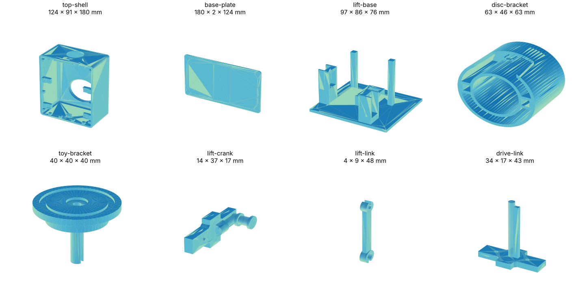

# Enclosure (v3.2)

Everything you need to print one Radar Desk Buddy case and its lift/pan
mechanism: the 8 STL files in this folder. Print one of each and assemble.

Assembled footprint: about **124 × 180 mm**. Height about **91 mm** to the tips
of the ears (about 75 mm to the flat top of the shell), without the figure.

## Parts

Print one of each, all 8 files.

| Part | File | Size (mm) | What it does |
|---|---|---|---|
| Top shell | [top-shell.stl](top-shell.stl) | 124 × 180 × 91 | Main case with ears |
| Base plate | [base-plate.stl](base-plate.stl) | 124 × 180 × 2.6 | Bottom cover |
| Lift base | [lift-base.stl](lift-base.stl) | 97 × 86 × 76 | Mechanism base with guide posts |
| Disc bracket | [disc-bracket.stl](disc-bracket.stl) | 63 × 46 × 63 | Bracket under the turntable |
| Toy bracket | [toy-bracket.stl](toy-bracket.stl) | 40 × 40 × 40 | Turntable the figure stands on |
| Lift crank | [lift-crank.stl](lift-crank.stl) | 14 × 37 × 17 | Crank on the lift servo horn |
| Lift link | [lift-link.stl](lift-link.stl) | 4 × 9 × 48 | Link between crank and lift |
| Drive link | [drive-link.stl](drive-link.stl) | 34 × 17 × 43 | Turntable drive link |

STL files are in millimetres. Some parts are exported in their assembly
orientation: rotate them in your slicer so the largest flat face sits on the
bed.

## Printing

Suggested starting point (any FDM printer):

- PLA or PETG, 0.2 mm layers, 3 walls, 15–20 % infill.
- Supports only where your slicer reports overhangs.
- Keep the radar window free of metal paint or metal-filled filament: the radar
  sees through plastic, not through metal.

## Hardware

- 2 × micro servo (SG90 or MG90S): one for lift, one for pan. See the parts
  list in the [main README](../README.md#parts).
- The figure stands on the toy bracket; a small magnet in the centre recess
  holds a flat-bottomed figure in place (optional).

An assembly guide and video will be added here.

## License

[CC BY 4.0](https://creativecommons.org/licenses/by/4.0/). You may print,
modify and share the files, including commercially, as long as you credit
Kymopsis.
